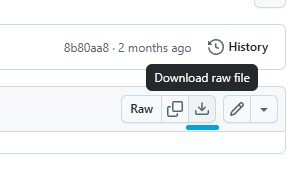

# How to Download a file from GitHub
Each GitHub folder contains a table listing all the files and folders within it. Click on the folder names until you reach the folder you want, and then click on the file. If the file is a small text file, its contents may be displayed. However, if the file is large or not text‑based, you’ll see a message saying something like: __(Sorry about that, but we can’t show files that are this big right now.)__.

To download the file, click on the __tray/downlooad__ icon in the upper‑right corner of the page and download as normal (blue line in Figure 1).

__Don’t right‑click on a file’s link and select “Save as”__, as you’ll only download a file containing a link to the final download page rather than the actual file.

Figure 1: Click on the download icon to download a file.
